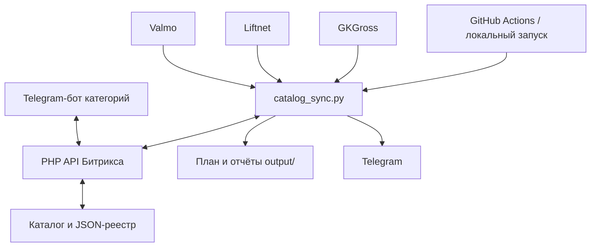

# Akomfort Catalog Sync

Автоматизация импорта и синхронизации каталога грузовой, коммерческой и дорожно-строительной техники интернет-магазина [АКомфорт](https://akomfort.tech/catalog/) на платформе 1С-Битрикс.

## Возможности

- Сбор товаров, описаний, характеристик и фотографий с сайтов поставщиков.
- Сопоставление товаров с существующими элементами Битрикса и разделами каталога.
- Создание новых карточек, загрузка фотографий и активация товаров.
- Постоянный JSON-реестр соответствий на стороне Битрикса; идентификация импортированных товаров по `XML_ID`.
- Формирование плана синхронизации и отчётов JSON, CSV и XLSX.
- Контролируемая деактивация отсутствующих товаров.
- Ручное исправление цен, характеристик, описаний, URL, категорий и галерей.
- Telegram-уведомления и согласование неопределённых категорий.

## Источники

| Поставщик | Сайт | Способ обхода | Цены |
|---|---|---|---|
| GKGross | https://gkgross.ru/ | Sitemap | Да |
| Liftnet | https://www.liftnet.ru/ | Списки товаров | Да |
| Valmo | https://valmo-rus.ru/ | Дерево каталога | Нет |

Для GKGross и Liftnet предусмотрена передача числовой цены и признака «от». Для Valmo цена не импортируется. Противоречивые характеристики Valmo выносятся на проверку.

## Архитектура



## Структура проекта

```text
.github/workflows/          # Автоматизация GitHub Actions
api/                       # PHP API для Битрикса
catalog_sync.py            # Основная синхронизация
catalog_sync_core/         # Парсинг, сопоставление, реестр, отчёты
config/catalog.json        # Источники, API, категории, ограничения
catalog/                   # Файлы каталога Битрикса
catalog.element/           # Шаблоны детальных карточек
catalog.section/           # Шаблоны списка товаров
sources/                   # Вспомогательные ресурсы
repair_*.py                # Ручное исправление импортированных товаров
cleanup_gallery.py         # Очистка галерей
fix_valmo_cards.py          # Исправления карточек Valmo
setup_commercial_sections.py # Настройка разделов
telegram_category_bot.py   # Бот согласования категорий
requirements.txt           # Python-зависимости
tests/                     # Тесты
output/                    # Локальные снимки и отчёты (не в Git)
```

## Запуск синхронизации

### Первичная инициализация реестра

Выполняется один раз, если реестр ещё не создан:

```bash
python -m dotenv run -- python catalog_sync.py --init-registry
```

### Предварительный просмотр (без записи в каталог)

```bash
python -m dotenv run -- python catalog_sync.py --out output
```

Проверьте `output/sync_plan.json`, предупреждения и результаты обхода.

### Применение изменений

```bash
python -m dotenv run -- python catalog_sync.py --out output --apply
```

### Создание с активацией новых товаров

```bash
python -m dotenv run -- python catalog_sync.py --out output --apply --activate-new
```

По умолчанию для активации новых товаров требуется главное изображение (настраивается в конфигурации).

### Деактивация

```bash
python -m dotenv run -- python catalog_sync.py --out output --apply --activate-new --allow-deactivate
```

Используйте только после проверки плана. Деактивация отключена по умолчанию. `--confirm-mass-deactivate` снимает ограничение количества кандидатов и не предназначен для штатного автоматического запуска.

| Параметр | Назначение |
|---|---|
| `--config` | Путь к конфигурации |
| `--out` | Каталог результатов |
| `--apply` | Разрешить запись |
| `--activate-new` | Активировать новые карточки |
| `--allow-deactivate` | Разрешить деактивацию кандидатов |
| `--resume` | Продолжить чтение с контрольной точки |
| `--reuse-snapshot` | Использовать существующий снимок для анализа |
| `--verbose` | Подробное логирование |

Запись с `--resume` или `--reuse-snapshot` запрещена: для применения нужен свежий обход.

## GitHub Actions

В настройках репозитория откройте **Settings → Secrets and variables → Actions** и добавьте необходимые переменные из `.env` как repository secrets.

Пример безопасного workflow для `.github/workflows/catalog-sync.yml` (сначала только построение плана):

```yaml
name: Catalog sync
on:
  workflow_dispatch:
  schedule:
    - cron: '17 */6 * * *'

permissions:
  contents: read

concurrency:
  group: akomfort-catalog-sync
  cancel-in-progress: false

jobs:
  sync:
    runs-on: ubuntu-latest
    timeout-minutes: 180
    env:
      AKOMFORT_IMPORT_TOKEN: ${{ secrets.AKOMFORT_IMPORT_TOKEN }}
      TG_BOT_TOKEN: ${{ secrets.TG_BOT_TOKEN }}
      TG_CHAT_ID: ${{ secrets.TG_CHAT_ID }}
    steps:
      - uses: actions/checkout@v4
      - uses: actions/setup-python@v5
        with:
          python-version: '3.11'
      - run: python -m pip install -r requirements.txt
      - run: python catalog_sync.py --out output
      - uses: actions/upload-artifact@v4
        if: always()
        with:
          name: catalog-sync-${{ github.run_id }}
          path: output/
          retention-days: 14
```

Расписание приведено в UTC. После успешного ручного запуска и проверки отчётов замените команду запуска на `python catalog_sync.py --out output --apply --activate-new`, если требуется автоматическое создание и публикация. Не включайте деактивацию и ремонтные скрипты без отдельного решения. Если workflow уже существует, адаптируйте его, не создавая второй параллельный запуск.

Штатная синхронизация не является универсальным обновлением всех полей существующих товаров: для цен и исправления контента предусмотрены отдельные операции. Telegram-бот категорий — отдельный процесс, а не постоянно работающий GitHub Actions job.

## Ручное обслуживание

Перед операциями, использующими снимок, выполните свежий сбор `catalog_sync.py --out output`. Начинайте с предварительного просмотра и малого лимита. Команды ниже предполагают загруженные переменные окружения.

```bash
# Проверка цен GKGross и Liftnet
python repair_imported_catalog.py --mode prices --limit 10
# Применение после проверки
python repair_imported_catalog.py --mode prices --apply --confirm-write

# Проверка описаний Valmo
python repair_valmo_content.py --limit 10
# Проверка URL
python repair_product_codes.py --limit 10
# Проверка недостающих свойств
python repair_cards.py --limit 10
# Проверка характеристик
python repair_imported_specs.py --limit 10
# Проверка галерей
python cleanup_gallery.py --limit 10
```

Дополнительные параметры и подтверждения доступны через `--help` каждого скрипта. Не запускайте массовый ремонт одновременно со штатной синхронизацией. При изменении URL отдельно проверьте необходимость 301-редиректов.

## Отчёты и хранение состояния

| Файл в output/ | Назначение |
|---|---|
| `source_products.json` | Снимок поставщиков |
| `target_products.json` | Снимок Битрикса |
| `crawl_status.json` | Состояние обхода источников |
| `snapshot_status.json` | Полнота снимка |
| `sync_plan.json`, `sync_plan.csv` | План операций |
| `catalog_sync.xlsx` | Табличный отчёт |
| `sync_results.json`, `sync_progress.jsonl` | Результаты и журнал записи |
| `valmo_content_conflicts.json` | Противоречия характеристик Valmo |
| `fatal_error.json` | Ошибка выполнения, если возникла |
| `checkpoints/` | Контрольные точки чтения |

Постоянные соответствия хранятся в JSON-реестре на стороне Битрикса через `matching.php`. Папка `output/` не нужна в репозитории для свежего запуска, но её снимки необходимы некоторым ремонтным скриптам. Сохраняйте нужные отчёты как артефакты и делайте резервные копии серверного реестра.

## Безопасность

- Не публикуйте `.env`, токены, пароли и серверные конфигурации с секретами.
- Проверяйте план перед записью; используйте HTTPS.
- Не меняйте `XML_ID` при исправлении символьного кода товара.
- Не деактивируйте товары по неполному обходу. В коде предусмотрены проверки ошибок создания, конфликтов связей и лимитов деактивации.
- Не запускайте несколько процессов записи одновременно, включая ручные запуски вне GitHub Actions.
- Перед обновлением PHP API и массовым ремонтом создавайте резервные копии.

## Тестирование

Запускайте тесты из `tests/` согласно используемому в текущей версии тестовому фреймворку. Для pytest, если он используется:

```bash
python -m pip install pytest
python -m pytest -q
```

Перед включением автоматической записи проверьте доступность API, полноту обхода, отсутствие дубликатов, создание одной тестовой карточки и отображение цены и фотографий на сайте.

## Диагностика

| Симптом | Что проверить |
|---|---|
| Реестр не инициализирован | `--init-registry`, адрес каталога и токен |
| HTTP 401/403 | Авторизацию API и переменные окружения |
| HTTP 400 при ремонте | Версию PHP-обработчика и параметры операции |
| Товар не опубликован | Флаг `--activate-new`, главное изображение |
| Не определена категория | Telegram-бот и правила реестра |
| Изменения не видны | Режим записи, отчёт операции и кеш Битрикса |

---

Проект предназначен для обслуживания каталога АКомфорт. Доступ к производственному API должен предоставляться только уполномоченным пользователям.
